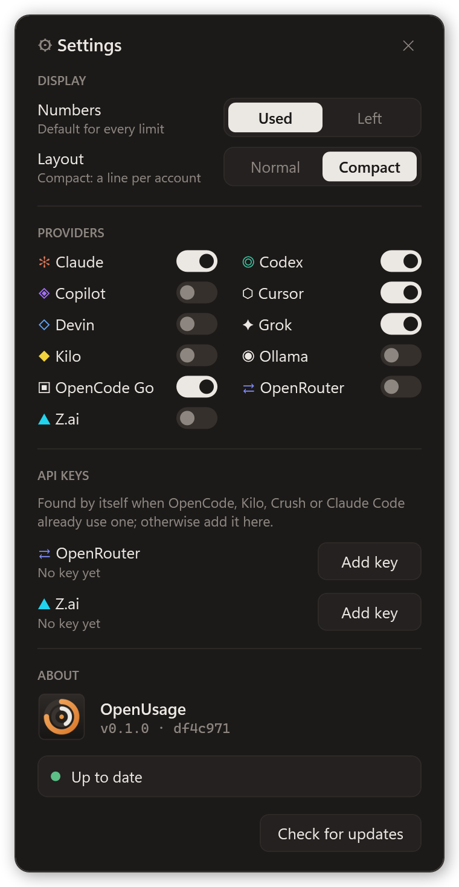
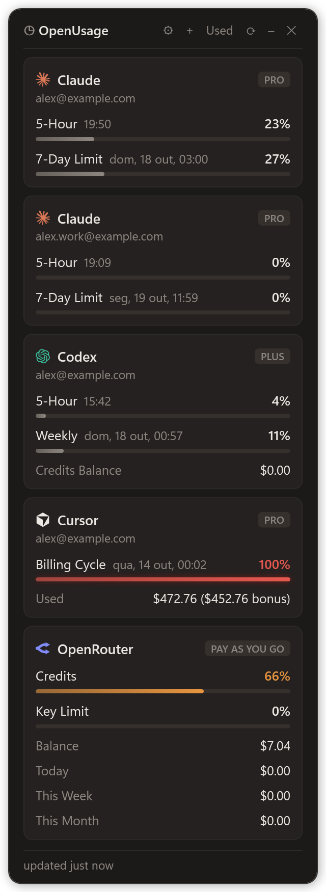
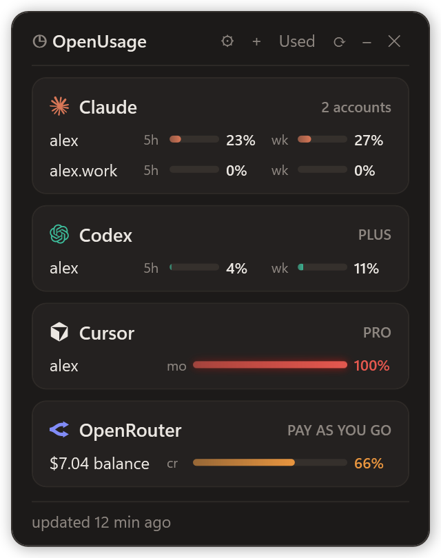
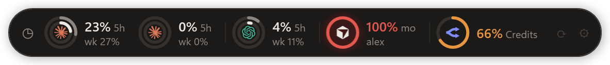
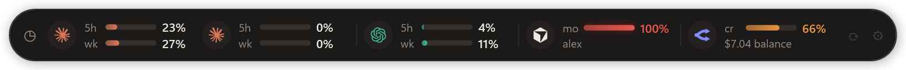

# Installing OpenUsage by hand

The easy way is to let your AI agent do it (see the [README](README.md)). This page has every step it follows, so you can do the same yourself, plus how the widget works, where each provider's data comes from, how to uninstall it and how the code is laid out.

- [Install](#install): [Windows](#windows) · [macOS](#macos) · [Linux](#linux)
- [Usage](#usage)
- [Providers](#providers) · [Multiple accounts](#multiple-accounts)
- [Uninstall](#uninstall)
- [Development](#development)

---

## Install

> If someone asked you to "install", "download" or "open" this plugin/widget, follow the steps below exactly. **Do not ask the user questions:** every step has a default.

> Check the operating system first: on **Windows** follow the steps right below; on **macOS** skip to [macOS](#macos); on **Linux** skip to [Linux](#linux).

### Windows

**Requirements:** Windows 10/11, PowerShell, Node.js >= 22.6 on `PATH`. Git is optional.

#### Step 1: make sure Node.js >= 22.6 is available

```powershell
node -v
```

If the command fails or the version is lower than `v22.6.0`, install Node LTS and reload `PATH` **in the same session** (otherwise the widget cannot find `node`):

```powershell
winget install --id OpenJS.NodeJS.LTS -e --accept-source-agreements --accept-package-agreements
$env:Path = [Environment]::GetEnvironmentVariable('Path','Machine') + ';' + [Environment]::GetEnvironmentVariable('Path','User')
node -v
```

#### Step 2: download (or update) into `%LOCALAPPDATA%\OpenUsage`

Always use this folder. The "Start with Windows" option creates a shortcut pointing into it, so it must not be a temporary location.

If the widget is already installed, this updates it. The first line closes a widget that is running: otherwise it keeps running the old version (only one instance runs at a time), and the ZIP path could not replace its folder.

```powershell
Get-CimInstance Win32_Process -Filter "Name='powershell.exe'" | Where-Object { $_.CommandLine -like '*usage-widget.ps1*' } | ForEach-Object { Stop-Process -Id $_.ProcessId -Force }
$dir = Join-Path $env:LOCALAPPDATA 'OpenUsage'
if (Test-Path (Join-Path $dir '.git')) {
  git -C $dir pull --ff-only
} elseif (Get-Command git -ErrorAction SilentlyContinue) {
  git clone https://github.com/paulocarinhena/OpenUsage.git $dir
} else {
  # No Git: download the main branch as a ZIP
  $zip = Join-Path $env:TEMP 'OpenUsage.zip'
  Invoke-WebRequest https://github.com/paulocarinhena/OpenUsage/archive/refs/heads/main.zip -OutFile $zip
  Expand-Archive $zip $env:TEMP -Force
  if (Test-Path $dir) { Remove-Item $dir -Recurse -Force }
  Move-Item (Join-Path $env:TEMP 'OpenUsage-main') $dir
  Remove-Item $zip
}
```

#### Step 3: create the desktop shortcut

```powershell
$dir = Join-Path $env:LOCALAPPDATA 'OpenUsage'
$lnk = (New-Object -ComObject WScript.Shell).CreateShortcut((Join-Path ([Environment]::GetFolderPath('Desktop')) 'OpenUsage.lnk'))
$lnk.TargetPath = Join-Path $env:WINDIR 'System32\wscript.exe'
$lnk.Arguments = "`"$dir\widget\usage-widget.vbs`""
$lnk.IconLocation = "$dir\widget\openusage.ico"
$lnk.Description = 'OpenUsage'
$lnk.Save()
```

This puts an **OpenUsage** icon on the desktop. Running it again just overwrites the same shortcut.

#### Step 4: open the widget

```powershell
Start-Process wscript.exe -ArgumentList "`"$env:LOCALAPPDATA\OpenUsage\widget\usage-widget.vbs`""
```

The widget opens without a console window. Only one instance runs at a time: if it is already open, this just brings it back into view (still on the version it started with), which is why Step 2 closes it first.

#### Step 5 (optional): verify

To confirm data is coming through, run the probe and show the output to the user:

```powershell
cd "$env:LOCALAPPDATA\OpenUsage"
node --experimental-strip-types --no-warnings scripts/probe.ts
```

A provider with an `"error"` field is **not an installation failure**: it means the user does not use that tool or is not signed in to it (see [Providers](#providers)). Tell the user and stop.

#### All at once

```powershell
$dir = Join-Path $env:LOCALAPPDATA 'OpenUsage'
if (-not (Get-Command node -ErrorAction SilentlyContinue) -or [version]((node -v).TrimStart('v')) -lt [version]'22.6.0') {
  winget install --id OpenJS.NodeJS.LTS -e --accept-source-agreements --accept-package-agreements
  $env:Path = [Environment]::GetEnvironmentVariable('Path','Machine') + ';' + [Environment]::GetEnvironmentVariable('Path','User')
}
# Close a running widget, so an update starts on the new version.
Get-CimInstance Win32_Process -Filter "Name='powershell.exe'" | Where-Object { $_.CommandLine -like '*usage-widget.ps1*' } | ForEach-Object { Stop-Process -Id $_.ProcessId -Force }
if (Test-Path (Join-Path $dir '.git')) { git -C $dir pull --ff-only } else { git clone https://github.com/paulocarinhena/OpenUsage.git $dir }
$lnk = (New-Object -ComObject WScript.Shell).CreateShortcut((Join-Path ([Environment]::GetFolderPath('Desktop')) 'OpenUsage.lnk'))
$lnk.TargetPath = Join-Path $env:WINDIR 'System32\wscript.exe'
$lnk.Arguments = "`"$dir\widget\usage-widget.vbs`""
$lnk.IconLocation = "$dir\widget\openusage.ico"
$lnk.Description = 'OpenUsage'
$lnk.Save()
Start-Process wscript.exe -ArgumentList "`"$dir\widget\usage-widget.vbs`""
```

(If Git is not installed, use the Step 2 block, which downloads the ZIP.)

### macOS

**Requirements:** macOS 12+, Node.js >= 22.6, Xcode Command Line Tools (they provide `git` and `swiftc`; the app is compiled on the Mac, so there is no unsigned download for Gatekeeper to block).

#### Step 1: make sure the tools are there

```bash
xcode-select -p >/dev/null 2>&1 || xcode-select --install   # opens Apple's installer; wait for it to finish
node -v
```

If `node` is missing or older than `v22.6.0`, install it with Homebrew (`brew install node`) or from [nodejs.org](https://nodejs.org).

#### Step 2: download (or update), build and open

Always use `~/Library/Application Support/OpenUsage`: the app reads the scripts from there.

```bash
dir="$HOME/Library/Application Support/OpenUsage"
if [ -d "$dir/.git" ]; then git -C "$dir" pull --ff-only; else git clone https://github.com/paulocarinhena/OpenUsage.git "$dir"; fi
"$dir/widget-mac/build.sh"
open "$HOME/Applications/OpenUsage.app"
```

`build.sh` compiles the widget into `~/Applications/OpenUsage.app` (findable in Spotlight and Launchpad). Run it again after every update.

The first time the Claude provider runs, macOS may ask whether `security` can read the **Claude Code-credentials** Keychain item: that is where Claude Code keeps its login on macOS. Click **Always Allow**.

#### Step 3 (optional): verify

```bash
cd "$HOME/Library/Application Support/OpenUsage"
node --experimental-strip-types --no-warnings scripts/probe.ts
```

As on Windows, a provider with an `"error"` field only means the user does not use that tool or is not signed in.

### Linux

**Requirements:** a desktop session (X11, or Wayland with XWayland), Python 3 with the GTK 3 bindings, Node.js >= 22.6 and Git.

#### Step 1: make sure the tools are there

```bash
python3 -c 'import gi; gi.require_version("Gtk", "3.0")' && node -v && git --version
```

If the GTK bindings are missing, install them: `sudo apt install python3-gi python3-gi-cairo gir1.2-gtk-3.0` (Debian, Ubuntu, Mint, Zorin), `sudo dnf install python3-gobject gtk3` (Fedora) or `sudo pacman -S python-gobject gtk3` (Arch). Most GNOME, Cinnamon, MATE and Xfce desktops already have them. If `node` is missing or older than `v22.6.0`, install it from your package manager, [nodejs.org](https://nodejs.org) or nvm.

#### Step 2: download (or update), install and open

Always use `~/.local/share/OpenUsage`: the app menu entry points into it.

```bash
dir="$HOME/.local/share/OpenUsage"
pkill -f 'widget-linux/openusage.py' || true   # an open widget keeps running the old version
if [ -d "$dir/.git" ]; then git -C "$dir" pull --ff-only; else git clone https://github.com/paulocarinhena/OpenUsage.git "$dir"; fi
"$dir/widget-linux/install.sh"
```

`install.sh` adds **OpenUsage** to the app menu (`~/.local/share/applications/openusage.desktop`), remembers where `node` is (so it also works with nvm) and opens the widget. Nothing is compiled.

#### Step 3 (optional): verify

```bash
cd "$HOME/.local/share/OpenUsage"
node --experimental-strip-types --no-warnings scripts/probe.ts
```

As on the other systems, a provider with an `"error"` field only means the user does not use that tool or is not signed in.

---

## Usage

### Header buttons

| Button | What it does |
|---|---|
| **⚙** | Settings (below). A dot on it means an update is waiting. |
| **+** | Adds another Claude or Codex account (see [Multiple accounts](#multiple-accounts)). |
| **Used / Left** | Flips every number between used and left. |
| **⟳** | Refreshes now (it also refreshes every 5 minutes). |
| **–** | Minimizes the widget to its title bar, still on screen; **□** brings the limits back (Windows). |
| **✕** | Hides the widget; the tray / menu bar icon brings it back. On Linux without a tray, it minimizes instead. |

### Reading the compact layout

```text
 ◔  paulo            5h   39%     outer ring  weekly limit (or the billing cycle)
    PRO · ↻ 00:19    wk   19%     inner ring  5-hour limit
```

- **↻** is when the 5-hour limit resets (or the weekly one, when there is no 5-hour limit).
- Colors follow the used share: **orange** from 50%, **red** from 80%. A used-up limit is a **full red ring** in both Used and Left.
- Providers you are not signed in to are left out; the Normal layout shows them with a hint on how to sign in.
- An account whose login needs attention (expired token, say) shows **!** and the reason.

Hover a line to see every limit with its reset time, the plan and any error.

### Settings



- **Numbers:** **Used** or **Left**, the default for every limit.
- **Layout:** **Compact** (a card per provider, a line per account: the ring, the plan and next reset, then the 5h / weekly numbers), **Normal** (a card per account with a bar per limit) or **Strip** (one slim pill, a chip per account with the provider's logo; drag it anywhere, its ⟳ and ⚙ light up under the pointer). Compact and Strip leave out providers you are not signed in to; Normal keeps them with a hint on how to sign in. A used-up limit is always a full red ring, even when showing what is left. On the right half of the screen the widget keeps its right edge in place, so the strip grows leftward.
- **Gauges:** **Rings** or **Bars**, for Compact and Strip. With bars each account in Compact takes a single short line: its name and a slim bar per limit.
- **Providers (Windows):** a switch per provider. The first time, only the tools found on the PC are on; each start looks again and turns on any tool installed since, while one you switched off stays off. A provider added by an update starts off unless its tool is found. Switch any of them on or off by hand; one switched off is no longer fetched or shown. The last one left on can't be switched off. (On macOS and Linux the widget shows the tools it finds.)
- **API keys:** OpenRouter and Z.ai, the services without a CLI sign-in. Each row says where its key was found (OpenCode, Kilo, Crush, Claude Code, an environment variable) or that there is none yet. **Add key** checks the key with the service before keeping it (in `~/.config/openusage/`, on this computer only) and turns the provider on; **Remove** forgets it. On Windows, switching on one with no key asks for it.
- **About:** the version and commit in use. The widget looks for a new version when it starts and once a day. **Update now** pulls it (`git pull --ff-only`) and restarts the widget; on macOS the app is rebuilt first. A copy installed from the ZIP (without Git) can't update itself: download it again.

<details>
<summary>Normal layout</summary>



</details>

<details>
<summary>Compact with bars</summary>



</details>

<details>
<summary>Strip, with rings or bars</summary>





</details>

### On Windows

Double-click `widget/usage-widget.vbs`.

- **Tray icon:** shows or hides the widget.
- **Desktop icon:** the installer puts an **OpenUsage** shortcut on the desktop.
- **Right-click the tray icon:** Refresh, Settings, Add account, Always on top, Start with Windows, Desktop shortcut and Quit.
- **Start with Windows:** creates a shortcut in `shell:startup` that opens the widget at login.
- **Desktop shortcut:** adds or removes the desktop icon.

### On macOS

Open **OpenUsage** from Spotlight, Launchpad or `~/Applications`.

- **Menu bar icon:** Show / hide, Refresh, Settings…, Add account…, Always on top, Start at login and Quit.
- **Drag the header** to move the widget; it remembers where you left it.
- **Start at login:** adds a LaunchAgent (`~/Library/LaunchAgents/com.openusage.widget.plist`) that opens the app at login.

### On Linux

Open **OpenUsage** from the app menu, or run `python3 widget-linux/openusage.py`.

- **Tray icon** (when the desktop has a tray): click to show or hide; right-click for the menu. On GNOME the tray needs the AppIndicator extension (Ubuntu and Zorin ship it) and, for the best icon, `gir1.2-ayatanaappindicator3-0.1`.
- **Right-click the header:** Refresh, Settings…, Add account…, Always on top, Start at login and Quit. This works with or without a tray.
- **Drag the header** to move the widget; it remembers where you left it.
- **Start at login:** adds `~/.config/autostart/openusage.desktop`.
- **Wayland:** the widget runs through XWayland, so it can stay on top and remember its place.

To see the raw data in a terminal: `npm run probe` (or `npm run probe -- claude cursor` to pick providers). To check for or apply an update from a terminal: `node --experimental-strip-types scripts/update.ts check` (or `apply`), or just `git pull`.

## Providers

The widget only **reads** credentials the tools themselves already saved on your machine. It never asks you to sign in and sends nothing anywhere except each service's own API. OpenRouter and Z.ai have no CLI login: their API key is picked up from the tools that already use it, or added once in Settings (below).

| Provider | Reads from | If it shows an error |
|---|---|---|
| Claude | `~/.claude/.credentials.json` (or `CLAUDE_CONFIG_DIR`); on macOS, the Keychain item Claude Code saves | Open Claude Code and sign in. Token expired: open Claude Code once to renew it. |
| Codex | `~/.codex/auth.json` (or `CODEX_HOME`); offline, falls back to the latest session log | Sign in to Codex with your ChatGPT account. API-key logins have no plan limits. |
| Copilot | The sign-in of the Copilot editor plugins (`apps.json` in `%LOCALAPPDATA%\github-copilot` or `~/.config/github-copilot`), else the GitHub CLI (`gh auth token`) | Run `gh auth login`. The monthly premium requests are shown; on the Free plan, chat and completions. |
| Cursor | `%APPDATA%\Cursor\User\globalStorage\state.vscdb`, `~/Library/Application Support/Cursor/User/globalStorage/state.vscdb` on macOS, or `~/.config/Cursor/User/globalStorage/state.vscdb` on Linux | Open Cursor and sign in. |
| Devin | The key saved by `devin auth login` (`~/.local/share/devin/credentials.toml`), else the Devin app's sign-in (`Devin/User/globalStorage/state.vscdb` in the app data folder) | Run `devin auth login`, or sign in to the Devin app. Shows the daily and weekly quota and the extra balance. |
| Grok | The login saved by `grok login` (`~/.grok/auth.json`, or `GROK_HOME`); an expired token is renewed and written back there, like the CLI does | Run `grok login`. Shows the weekly pool and the pay-as-you-go cap. Team logins have no personal quota. |
| Kilo | The Kilo account saved by `kilo auth login` (`~/.local/share/kilo/auth.json`) | Run `kilo auth login` with your Kilo account. Shows the credit balance and, with Kilo Pass, the month's usage. |
| Ollama | The key Ollama creates at `~/.ollama/id_ed25519`, linked to your account by `ollama signin`; each request is signed with it, the key never leaves the machine | Shows up by itself once that key is linked to an ollama.com account (only local models: it stays out of the way). Run `ollama signin`. Shows the monthly credits, or the 5h / weekly limits on older plans. |
| OpenCode Go | `OPENCODE_GO_API_KEY`, or the key saved by opencode's `/connect` | Run `/connect` in opencode and pick OpenCode Go. |
| OpenRouter | A key added in Settings, else `OPENROUTER_API_KEY`, else the one OpenCode, Kilo or Crush already use, or Claude Code's when pointed at OpenRouter | No key on the computer: add one in **Settings → API keys** ([create it here](https://openrouter.ai/keys)). Shows credits used, balance, the spend today / this week / this month and the key's own cap. |
| Z.ai | A key added in Settings, else `ZAI_API_KEY`, else the GLM Coding Plan key OpenCode, Kilo or Crush already use, or Claude Code's when pointed at `api.z.ai` | No key on the computer: add one in **Settings → API keys** ([get it here](https://z.ai/manage-apikey/apikey-list)). Needs a GLM Coding Plan. Shows the 5h and weekly limits and the month's web searches. |

### Multiple accounts

Claude Code and Codex keep one login per config folder, so each extra account gets its own folder in your home (`.claude-2`, `.codex-work`…) and a command that opens it, like `claude2`. The widget finds these folders and shows one card per account.

- **In the widget (Windows, macOS, Linux):** click **+** in the widget header (or **Add account** in the tray / menu bar menu), pick a command name and sign in with the other account in the terminal that opens.
- **Or from any terminal:**

  ```bash
  npm run add-account -- claude claude2   # then sign in and type /exit
  npm run add-account -- codex codex2     # signs in through the browser
  ```

After that, `claude` opens your main account and `claude2` the other one, in any terminal (the same goes for `codex` / `codex2`). The command lives next to `claude` on Windows and in `~/.local/bin` elsewhere. If nothing was signed in, or the browser signed in to your main account again, the new folder and command are removed; sign out in the browser (or use a private window) and try again.

Claude tokens are only renewed by Claude Code itself, so open `claude2` now and then to keep its card fresh. To remove an account, delete its folder and command.

## Uninstall

**Windows**

1. Right-click the tray icon, uncheck **Start with Windows** and **Desktop shortcut**, then click **Quit**.
2. Delete `%LOCALAPPDATA%\OpenUsage` and `%APPDATA%\usage-widget`.

**macOS**

1. In the menu bar icon, uncheck **Start at login**, then click **Quit**.
2. Delete `~/Applications/OpenUsage.app`, `~/Library/Application Support/OpenUsage` and `~/Library/Application Support/usage-widget`.

**Linux**

1. Right-click the widget header and click **Quit**.
2. Run `python3 ~/.local/share/OpenUsage/widget-linux/openusage.py --uninstall` (removes the app menu entry and the autostart entry), then delete `~/.local/share/OpenUsage` and `~/.config/usage-widget`.

## Development

```powershell
npm install        # only needed for typecheck
npm run typecheck
npm run probe
```

Layout:

- `src/providers/`: one file per provider, all returning the same shape (`ProviderUsage` in `types.ts`).
- `scripts/usage-json.ts`: prints every provider as one JSON array; this is what the widget calls.
- `scripts/update.ts`: the version, and the self-update behind **Update now** (`check` / `apply`).
- `scripts/keys.ts`: the API keys behind **Settings → API keys**: which were found, and checking and keeping a pasted one.
- `scripts/add-account.ts`: adds another Claude or Codex account (folder, command, sign-in); the widgets' **+** button runs it.
- `widget/usage-widget.ps1`: the WPF UI. The `.vbs` only launches it without a console.
- `widget/openusage.ico`: the app icon, used by the tray and the shortcuts.
- `widget-mac/OpenUsage.swift`: the macOS app (AppKit + SwiftUI). `widget-mac/build.sh` compiles it into `OpenUsage.app`.
- `widget-linux/openusage.py`: the Linux app (Python + GTK 3). `widget-linux/install.sh` adds it to the app menu.
- `assets/providers/*.svg`: the provider logos the three widgets draw (one path each, filled with the provider's color). Linux renders them with librsvg, the usual GTK SVG loader; without it the widget falls back to a glyph.
